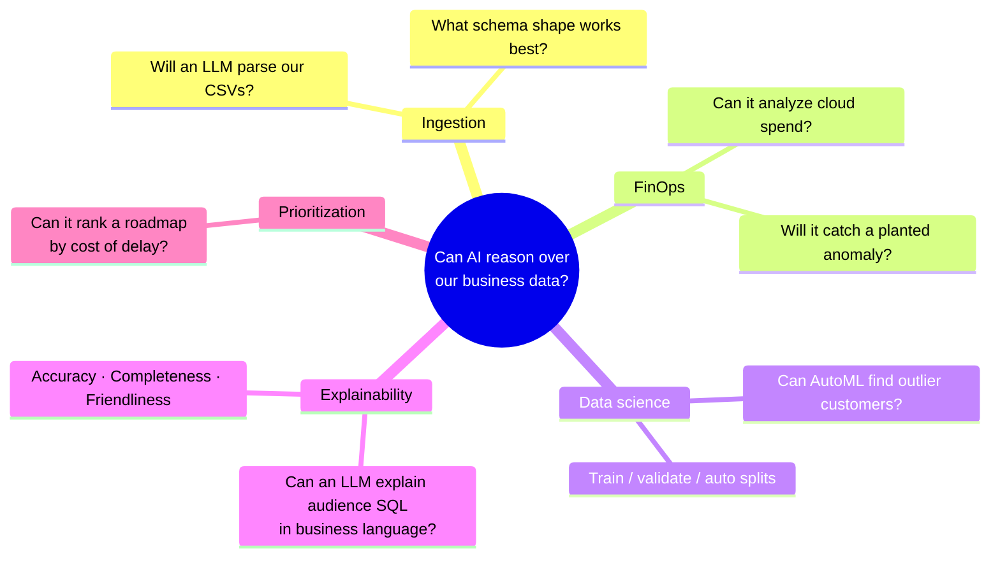
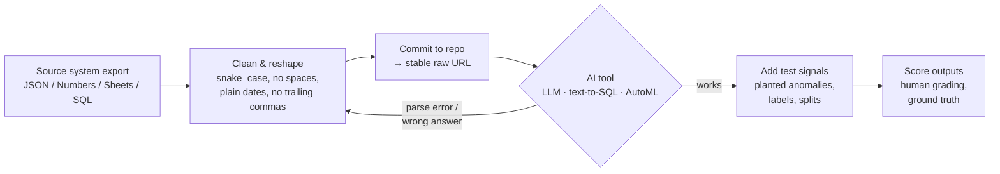
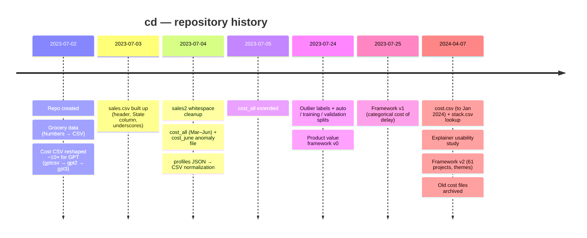

# `cd` — A Test Bench of Datasets for AI-Powered Analytics

> A collection of CSV datasets used between **July 2023 and April 2024** to test how well large language models and AutoML tools handle realistic business data: cloud cost analysis, customer profiles, anomaly detection, roadmap prioritization, and plain-English explanations of audience logic.


-orange)

---

## Table of Contents

1. [TL;DR](#tldr)
2. [The Goal](#the-goal)
3. [How It Worked](#how-it-worked)
4. [The Five Workstreams](#the-five-workstreams)
   - [1. Making CSVs LLM-friendly](#1-making-csvs-llm-friendly)
   - [2. Cloud cost analysis (FinOps)](#2-cloud-cost-analysis-finops)
   - [3. Customer profiles & outlier detection](#3-customer-profiles--outlier-detection)
   - [4. AI Audience Explainer usability study](#4-ai-audience-explainer-usability-study)
   - [5. Product Value Framework](#5-product-value-framework)
5. [Outcomes Delivered](#outcomes-delivered)
6. [Lessons Learned](#lessons-learned)
7. [Dataset Catalog](#dataset-catalog)
8. [Timeline](#timeline)
9. [Caveats & Housekeeping](#caveats--housekeeping)

---

## TL;DR

| | |
|---|---|
| **What it is** | A data-only GitHub repository: 20 CSV files and no code. |
| **Why it exists** | To provide stable, URL-addressable test data for trying out AI tools (ChatGPT-style "chat with your CSV", text-to-SQL, AutoML, LLM summarization) on problems from a customer data platform (CDP) product. |
| **How** | Real exports (cloud costs, roadmap sheets, usability gradings) and synthetic exports (customer profiles), repeatedly reshaped until AI tools could parse them, with planted anomalies and labeled ground truth added for scoring. |
| **What it delivered** | A hardened CSV format for LLMs, a FinOps view of ~$5.1M in EC2 spend, a labeled outlier benchmark with train/validation splits, a 128-sample human evaluation of an AI explainer, and a cost-of-delay prioritization of a 61-project roadmap. |

> [!NOTE]
> The repo has no README history, notebooks, or prompts, so the **goals** below are inferred from the data, file names, and commit history. The **numbers** were computed directly from the files. Wherever something is an inference, it is labeled as one.

---

## The Goal

The domain clues point to a product manager at a customer data platform company. The data includes `aiq_id` and `AIQ_segmentId` keys, "audiences", "lookalike features", and product lines such as *HybridCompute*, *Query Service*, *Pipelines*, *Journeys*, and *Triggers*. The PM was exploring one broad question:

> **Can generative AI and AutoML reliably turn our business data into correct answers and explanations that business users can trust?**

That question split into five concrete experiments:



---

## How It Worked

The working method was simple: the GitHub repo acted as a **public file host**. Each CSV got a stable raw URL, so a chat-based AI tool (ChatGPT plugins and Code Interpreter were current at the time) or a Hugging Face space could fetch it directly. When a tool choked on a file, the fix was committed and the tool was pointed at the file again.



The commit log shows this loop clearly. For example, on **July 2–4, 2023** the same cost file was renamed and reshaped **10 times in under 48 hours** (`costcsv → gptdata → gptcsv → gpt2 → gpt3`), and the sales file went through **8 revisions**.

---

## The Five Workstreams

### 1. Making CSVs LLM-friendly

**Files:** `gpt3.csv`, `sales.csv`, `sales2.csv`, `small_cost_csv.csv` (plus deleted `gptcsv.csv`, `gpt2.csv`)

**Goal:** Find the CSV shape that LLM data tools read reliably on the first try.

**What changed, commit by commit:**

| Problem found | Fix applied | Evidence |
|---|---|---|
| A column named `date` (a SQL reserved word that tools handle ambiguously) | Renamed to `relevant_date` | `gptcsv.csv` @ `2d3c602` |
| A trailing comma on every row created a phantom empty column | Removed it | `gptcsv.csv` @ `0fca3d0` |
| ISO timestamps such as `2023-06-01T00:00:00.000+0000` | Simplified to `2023-06-01` | `gpt3.csv` @ `eb1be40` |
| 722 rows were too large for a chat context window | Truncated to a **10-row sample** | `gpt2.csv` @ `26af0b5` |
| An ambiguous `cost` column | Tried `dollar cost` as a semantic hint, then reverted | `bf90154` |
| No header row | Header added | `sales.csv` @ `0b67e77` |
| Spaces in column names (`Sales Change Vs 2021`) | Changed to `Sales_Change` | `sales.csv` @ `4dd1d71`, `bce1e6b` |
| Whitespace after delimiters (`1, 'Toyota', ...`) | Stripped, giving `sales2.csv` | `3f1382e`, `f565645` |
| Only one dimension available for grouping | Added a `State` column (NY/NJ/CT/TX) for group-by tests | `sales.csv` @ `1c5d37c` |

`sales*.csv` contains 2022 US auto sales for 36 brands with year-over-year change. `small_cost_csv.csv` is a deliberately messy 3-row edge case with space-padded headers, a trailing comma, and fake instance types (`a5.2xlarge`).

**Outcome:** a repeatable recipe for making CSVs LLM-friendly (see [Lessons Learned](#lessons-learned)).

---

### 2. Cloud cost analysis (FinOps)

**Files:** `cost.csv`, `ARCHIVE_cost_all.csv`, `ARCHIVE_cost_all_columns.csv`, `cost_june.csv`, `gpt3.csv`, `stack.csv`

**Goal:** Let an AI answer FinOps questions about daily AWS EC2 spend, such as "where is the money going?", "what does a core-hour cost?", and "how much capacity are we paying for but not using?"

**Schema evolution:** the files grew from 9 columns to 15. The later files add Spark executor packing (`executor_cpu`, `num_executors`), `memory_gb`, and the key waste metric, `unallocated_core_seconds`. `stack.csv` is a lookup table that maps all 83 instance types to a stack (`cmp` = compute, `io` = I/O) and a disk profile (`no_disk` / `attached_disk`), so the AI can be tested on **multi-table joins**.

**What the data shows:**

| Metric | Value |
|---|---|
| Tracked EC2 spend, Mar 2023 → Jan 19, 2024 | **≈ $5.1M** |
| Share of spend on `io` stacks | **~77%**, stable across every file |
| Instance types in use | 41 (Mar–Nov 2023) → **83** (Nov 2023–Jan 2024) |
| Largest single line item in the latest file | `i3.4xlarge`, **$285K** in ~11 weeks (absent from earlier files) |

**Unallocated cores** (paid core-seconds not assigned to Spark executors) fell sharply, while the blended cost per core-hour rose:

| Month (2023) | Mar | Apr | May | Jun | Jul | Aug | Sep | Oct | Nov |
|---|---|---|---|---|---|---|---|---|---|
| Unallocated cores | 30.1% | **47.0%** | 41.3% | 13.5% | 16.6% | 11.3% | 12.8% | **9.6%** | 9.6% |
| Blended $/core-hr | 0.0264 | 0.0268 | 0.0272 | 0.0329 | 0.0331 | 0.0313 | 0.0296 | 0.0347 | **0.0372** |

> **Read:** idle-core waste fell by about **5× (47% → ~10%)** between April and October 2023 and stayed near 12% through January 2024. Over the same period the blended price per core-hour rose by about **40%**. This pattern fits a shift toward denser or pricier instance families. The data alone can't confirm the cause.

**The anomaly trap.** `cost_june.csv` contains one planted row to test whether the AI notices bad data:

```csv
2023-07-01,r6in.2xlarge,cmp,prod,740000.99626961840000,245.677488,8,7075511.6544,0.03815788649833480
```

The original row (dated 2023-06-28 in the first `cost_all.csv` commit, `eb1be40`) cost **$74.99**. The planted copy is re-dated to July 1 and keeps the same hours, core-seconds, and per-core-hour rate but inflates the cost by **~10,000×**. A competent analysis has to flag it. A naive one reports July spend of $740K from a single day. `gpt3.csv` contains a similar trap: a duplicated row re-dated to the next day.

---

### 3. Customer profiles & outlier detection

**Files:** `profiles.csv`, `profiles_data_with_outliers*.csv` (full, `_auto`, `_training`, `_validation`)

**Goal:** Test whether an AutoML or anomaly-detection tool can find suspicious customer records in a CDP segment, and score it against known answers.

**How it was built:**

1. **Raw export** (`profiles.json`, now deleted) used platform-native column names such as `[LAL_Feature]_Orders_-_quantity`, `[Jha]_total_orders`, and `Account_Size_(S/M/L)`.
2. **Normalized** to clean `snake_case` CSV. One intermediate version (`profiles2.csv`) leaked stray quotes into names and was discarded.
3. **74,334 synthetic profiles** in segment `368952`. The emails are fake (`@example.com`, `@notgmail.com`, `@nowhere.com`) and the data is clearly test fixtures.
4. **Labeled** with a boolean `outliers` column and **split** into evaluation sets.

**The hidden ground-truth rule.** The labels follow a single deterministic rule, recovered here with **0 false positives and 0 false negatives**:

```text
outlier  ⇔  total_orders = 1  AND  tenure_length = 0  AND  orders_quantity ∈ {3, 4, 5}
```

That describes a brand-new customer whose single order contains an unusually large quantity. The dataset also plants **975 decoys**: customers with the same profile but quantity 1–2, labeled *not* outliers. A model has to learn the quantity threshold, not just "new customer with one order".

| File | Rows | Outliers | Rate | Slice |
|---|---:|---:|---:|---|
| `profiles_data_with_outliers.csv` | 74,334 | 1,493 | 2.0% | full population |
| `…_auto.csv` | 15,101 | 278 | 1.8% | first ~20% (input for AutoML) |
| `…_training.csv` | 1,488 | 22 | 1.5% | first ~2% (subset of `_auto`) |
| `…_validation.csv` | 436 | 9 | 2.1% | last 436 rows (held out, no overlap) |

A later edit renamed `lookalike_feature_orders_quantity` to `order_propensity` in `profiles.csv` only. That looks like a probe of whether the AI reads meaning into column names, since the values are a quantity, not a propensity.

---

### 4. AI Audience Explainer usability study

**File:** `explainer_usability.csv` (added April 2024)

**Goal:** Decide whether an LLM can turn the SQL behind a marketing **audience** into a plain-English description that a business user can trust.

**Method:** **9 internal testers** graded **128 AI explanations** across **48 real audiences**, over up to 3 prompt iterations ("runs"). Each AI explanation sits next to a human-written one and is graded *Success / Fail / Not sure* on three criteria.

**Results:**

| Criterion | Success | Graded | Pass rate |
|---|---:|---:|---:|
| Accuracy | 62 | 118 | **53%** |
| Completeness | 64 | 117 | **55%** |
| Business-friendly | 55 | 126 | **44%** |
| **All three** | **22** | 128 | **17%** |

| Finding | Evidence |
|---|---|
| **SQL leakage was the biggest problem.** | Explanations that mention SQL, joins, tables, queries, or `aiq_id` passed business-friendliness **20 vs 35** (pass vs fail). Jargon-free ones passed **35 vs 19**. |
| **AI output was about 2× longer than a human's.** | Median of **40 words** for AI vs **19** for human; graders repeatedly called it "wordy". |
| **Prompt iteration barely helped.** | Business-friendliness went from 43% (run 1) to 45% (run 2). Accuracy went from 52% to 54%. |
| **Hallucinations** | Invented intent ("…to target them with special offers"), swapped inclusion and suppression lists, wrong lookback windows (30 days vs 2 days), leaked process text ("final summary after 5 iterations"). |
| **Metadata gaps** | Business attribute names didn't match column names (a model score called "churn"), so the AI described the SQL rather than the business concept. |
| **Occasional win** | One grader noted the AI got an audience right that they had described wrongly by hand. |

**Recommendations from the graders:** forbid SQL vocabulary in the prompt (`SQL`, `query`, `intersect`, `except`); feed in **attribute business names and metadata**, not just raw SQL; and enforce brevity.

---

### 5. Product Value Framework

**Files:** `Product 1.csv`, `Product_2.csv`, `Product Value Framework - Product (2).csv` (plus deleted `Product.csv`)

**Goal:** Score the product roadmap with a **cost-of-delay** framework and see whether an AI can reason over it (for example, "what should we cut?" or "which bets are strategic and unaligned?").

**How the framework evolved:**

| Version | Date | Scoring model |
|---|---|---|
| v0 `Product.csv` | Jul 24, 2023 | Numeric 0–3 scores per dimension, plus ICE-style `Criticality / I / E` (H/M/L) |
| v1 `Product 1.csv` | Jul 25, 2023 | Categorical **None / Small / Medium** across 4 cost-of-delay dimensions. 33 projects, cycles 1–2. |
| v2 `Product_2.csv` | Apr 2024 | Adds `Number` and `Themes`, plus the **Large** level. **61 projects**, cycles 1–4. |

**Snapshot (v2, 61 projects, 3 PMs, 5 teams: C360, EXE, CX, CINT, RT):**

| Dimension | Result |
|---|---|
| Aligned to a company KR | **48 / 61 (79%)** |
| Strategic vs incremental | **34 S / 27 I** |
| Has *usage* cost of delay | 32 projects |
| Has *churn-risk* cost of delay | 26 |
| Has *revenue* cost of delay | 14 |
| Has *risk* cost of delay | 6 |
| Top themes | Configuration & Access (8), Pipelines (7), Spark 3 (7), Hybrid Compute (6) |
| Most-cited KR | Net Retention ≥ 120% |

> **Read:** the roadmap is justified mostly by **retention and usage**, rarely by direct revenue. The `Status` column is empty in every version, so the framework was used for **prioritization, not tracking**.

`Product Value Framework - Product (2).csv` is a near-copy of `Product_2.csv` with 5 cells that use **"Low"** where the other file uses **"Small"**. That mismatch is a vocabulary inconsistency an AI should catch, whether or not it was planted on purpose.

---

## Outcomes Delivered

| # | Outcome | Status |
|---|---|---|
| 1 | **A CSV format that LLM tools reliably parse**: snake_case, no spaces, no reserved words, plain dates, small samples | ✅ Proven through iteration |
| 2 | **FinOps visibility**: ≈$5.1M of tracked spend, a 77% `io` concentration, and idle cores cut from 47% to ~10% | ✅ Data in place, trend measurable |
| 3 | **Anomaly-detection traps** (a 10,000× cost spike and a duplicate row) | ✅ Planted |
| 4 | **Labeled outlier benchmark**: 74K rows, a 2% positive rate, decoys, and train/validation/auto splits | ✅ Ready to use (model results not stored here) |
| 5 | **Human evaluation of the AI Audience Explainer**: 128 graded samples | ✅ Complete. **Verdict: not ready**, with 17% passing all three criteria and SQL leakage as the top issue. |
| 6 | **Cost-of-delay roadmap scoring** for 61 projects | ✅ Framework designed and populated |

> [!IMPORTANT]
> The repo holds the **inputs** and one set of **human-graded outputs** (the explainer study). It does **not** contain the AI tools' answers for the cost, outlier, or roadmap experiments, so those outcomes can't be scored from this repo alone.

---

## Lessons Learned

**Shaping data for LLMs**
- Use `snake_case` headers with no spaces, punctuation, or brackets (`[LAL_Feature]_…` → `lookalike_feature_…`).
- Avoid reserved words as column names (`date` → `relevant_date`).
- Use plain `YYYY-MM-DD` dates rather than full ISO timestamps with zones.
- Never end rows with a trailing comma, and never put whitespace after delimiters.
- Ship a **10-row sample** for chat-based exploration and the full file for code execution.
- Keep lookup tables separate (`stack.csv`) to test whether the tool can join them.

**Evaluating AI on business data**
- **Plant the answer** before asking the question: anomalies, decoys, and duplicates turn "looks plausible" into pass/fail.
- **Recoverable ground truth** (a single deterministic rule) makes model evaluation unambiguous.
- Grade explanations on **accuracy, completeness, and audience fit separately**. They fail independently.
- **Metadata matters more than prompts.** Explainer quality was limited by missing business names for attributes, not by wording.

---

## Dataset Catalog

| File | Rows | Cols | Domain | Purpose |
|---|---:|---:|---|---|
| `cost.csv` | 12,631 | 15 | FinOps | Latest daily EC2 cost (Nov 2023 → Jan 2024), 83 instance types |
| `ARCHIVE_cost_all_columns.csv` | 7,476 | 15 | FinOps | Mar → Nov 2023 with executor and unallocated-core detail |
| `ARCHIVE_cost_all.csv` | 6,809 | 9 | FinOps | Mar → Sep 2023, original 9-column schema |
| `cost_june.csv` | 722 | 9 | FinOps | June 2023 slice **plus a planted $740K anomaly** |
| `gpt3.csv` | 11 | 9 | FinOps | 10-row LLM sample **plus a duplicate-row trap** |
| `small_cost_csv.csv` | 3 | 7 | FinOps | Deliberately malformed edge case |
| `stack.csv` | 91 | 3 | FinOps | Instance type → stack and disk-type lookup |
| `profiles.csv` | 74,334 | 16 | CDP | Synthetic customer profiles, segment 368952 |
| `profiles_data_with_outliers.csv` | 74,334 | 18 | CDP / ML | Same profiles plus `outliers` label |
| `profiles_data_with_outliers_auto.csv` | 15,101 | 18 | CDP / ML | AutoML input slice |
| `profiles_data_with_outliers_training.csv` | 1,488 | 18 | CDP / ML | Training slice |
| `profiles_data_with_outliers_validation.csv` | 436 | 18 | CDP / ML | Held-out validation slice |
| `explainer_usability.csv` | 128 | 12 | GenAI eval | Human grades of AI audience explanations |
| `Product 1.csv` | 33 | 12 | Product ops | Value framework v1 |
| `Product_2.csv` | 61 | 14 | Product ops | Value framework v2 |
| `Product Value Framework - Product (2).csv` | 61 | 14 | Product ops | v2 variant using "Low" vs "Small" |
| `sales.csv` / `sales2.csv` | 36 | 5 | Toy | 2022 US auto sales by brand (raw vs cleaned) |
| `huggingface grocery.csv` | 18,894 | 16 | Retail | Grocery price list: EAN, size, 6 regional price zones, merch category. Converted from Apple Numbers for a Hugging Face test. 91% of SKUs vary in price by zone. |

---

## Timeline



---

## Caveats & Housekeeping

- **Intent is inferred.** No code, prompts, or tool outputs are committed. The goals and methods above are reconstructed from data, file names, and 30 commits.
- **Visibility.** This repository is **public**. It contains what appear to be internal infrastructure costs, roadmap items with KRs, and named colleagues' usability feedback. Consider making it private or scrubbing those files if that wasn't intended.
- **Synthetic PII.** The profile names, emails, and addresses are generated test data (fake domains, `\N` placeholders), not real customers.
- **Hygiene:** `.DS_Store` is tracked. Several file names contain spaces and parentheses, which breaks naive URL and shell use. `ARCHIVE_cost_all.csv` mixes `null` and `prod` in `env` and mixes two date formats.
